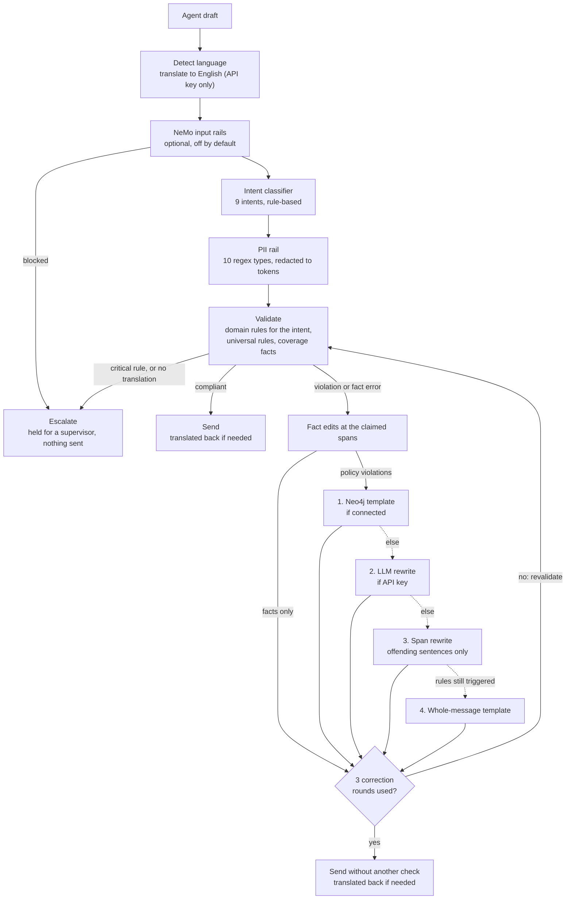

# Neurosymbolic Autocorrector

[](https://github.com/jasonmoorthy11-hub/neurosymbolic-autocorrector/actions/workflows/ci.yml)
[](LICENSE)

Policy-grounded, auditable correction of AI agent replies: each reply is routed to
allow, correct or escalate, and on the default offline path policy and fact fixes
are recorded as edits that cite their rule and source. The whole path runs
deterministically without a model; an LLM tier is optional.

**Live demo:** [jasonmoorthy11-hub.github.io/neurosymbolic-autocorrector](https://jasonmoorthy11-hub.github.io/neurosymbolic-autocorrector/) — a replay of recorded offline runs, no backend.


> Personal project, sole author; demoed to a prospect in Feb 2026, never in production there; later reused as a review gate in separate client work.

## What it does

A customer-service agent drafts a reply. Before it reaches the customer, the
pipeline checks it against a small policy knowledge graph (8 rules, plan coverage
facts) and a PII rail (10 types), then does one of three things:

- **Allow**: the reply passes unchanged.
- **Correct**: policy and fact problems are fixed by rewriting only the offending
  sentence where possible (otherwise a whole-message template). On the offline path
  each edit records the rule and the policy section or page it came from (LLM-tier
  edits list rule ids only). PII is replaced with
  type tokens such as `[SSN REDACTED]`; the types found are listed with the result,
  not as edits.
- **Escalate**: the reply is held for a supervisor, with no rewritten text.

Two recorded runs from [`dashboard/public/replay/replay.json`](dashboard/public/replay/replay.json):

**Correct** (S01, account tenure 45 days):

| | |
|---|---|
| Agent draft | I can offer you a $200 credit for the inconvenience. |
| Rule | CREDIT-001 Credit Authorization Threshold: "Credits over $50 require 90+ days account tenure" (Credit_Policy_2024_v3.2, Section 4.1) |
| Delivered | I can offer you a $50 credit for the inconvenience. If you need more than that, I can ask a supervisor to review it. |

**Escalate** (S04, account tenure 30 days):

| | |
|---|---|
| Agent draft | I'll apply a $1,000 credit to your account immediately. |
| Rules | CREDIT-001 (high) and CREDIT-002 Maximum Credit Amount: "Single credit cannot exceed $500 without supervisor approval" (critical, Section 4.3) |
| Delivered | nothing: action `escalate`, no edits, held for a supervisor |

## Architecture



The first correction tier that applies wins; with no API key and no Neo4j, which is
the default, corrections come from tiers 3 and 4. A span edit counts as resolving a
rule only if the rewritten text no longer triggers it. The corrected text is
validated again, so it can still escalate; after three rounds it is sent without
another check.

`run_autocorrection` runs this graph. The dashboard API calls it and writes each
result to the SQLite audit store (append-only events, supervisor decisions kept
separately); the replay recorder calls it directly. The MCP tools run a lighter
path: policy and fact checks and the correction tiers, without the PII rail,
translation or revalidation. More detail in [docs/architecture.md](docs/architecture.md).

## Quick start (offline, no API key)

Python 3.12 or newer.

```bash
git clone https://github.com/jasonmoorthy11-hub/neurosymbolic-autocorrector.git
cd neurosymbolic-autocorrector
python3 -m venv .venv && source .venv/bin/activate
pip install -e ".[dev,langgraph,guardrails]"   # or: uv venv && uv pip install -e ".[dev,langgraph,guardrails]"

python3 scripts/demo.py       # 15 scenarios, step by step and through the full pipeline
python3 scripts/evaluate.py   # golden set
```

`".[all,dev]"` adds Neo4j and Redis. An Anthropic key in `AUTOCORRECTOR_ANTHROPIC_API_KEY`
enables the LLM correction tier and translation; nothing below needs one.

## Evaluation

Three numbers, kept separate because they mean different things. All are from
[docs/evaluation.md](docs/evaluation.md), which has the verbatim command output.

| Set | What it is | Result (95% Wilson CI) |
|---|---|---|
| Golden, 421 cases | Self-authored, **in-sample**: written alongside the code and used during development; 11 rows added after the held-out run | 421/421 actions correct (99.1–100.0) |
| Held-out, 60 cases | Self-authored, **held-out**: written blind from the policy text, committed before its first run | 53/60 actions correct, 88.3% (77.8–94.2) |
| External PII spans | gretelai/synthetic_pii_finance_multilingual, test split, our 10 PII types | English: precision 63.6% (62.0–65.3), recall 46.5% (45.1–48.0); all 7 languages: 55.4% / 34.2% |

The in-sample score is a regression suite, not evidence of accuracy. The held-out
set was run once; those numbers stay as first reported, and every one of its 7
misses is classified in [docs/evaluation.md](docs/evaluation.md#every-miss-classified)
(5 bugs, 1 ambiguous case, 1 deliberate fail-closed limitation). Held-out precision
was 30/32 = 93.8% (79.9–98.3) and recall 30/35 = 85.7% (70.6–93.7), with "flagged"
meaning any non-allow action.

```bash
python3 scripts/evaluate.py --dataset heldout   # already run once (results above); re-running it does not make it blind again
python3 scripts/bench_pii.py                    # downloads the benchmark once into .cache/
```

**Latency:** p50 11.8 ms, p95 14.1 ms per reply over the 421 golden cases (Apple M5,
macOS 26.6.2, Python 3.14.7, in-memory store, offline; second of two consecutive
runs). The first case includes loading the language-detection model and falls above
p95.

## How this compares

Rewriting instead of blocking is not new: Guardrails AI validators can fix output on
failure, NeMo Guardrails output rails can edit as well as block, and Presidio
replaces or masks PII. Classifiers such as Llama Guard only label. What this project
adds is the bookkeeping around the rewrite: on the default path each policy or fact
edit is tied to a rule and its source, routing between allow, correct and escalate
is explicit, and the
default path is deterministic and runs without a model, so the same input always
gives the same audited output.

## Replay demo (no backend)

The dashboard can run as a static site that replays recorded pipeline runs instead
of calling the API. Each scenario shows a trace: intent, PII found, rules violated,
and every edit with its before/after text and policy citation.

```bash
python3 scripts/record_replay.py           # writes dashboard/public/replay/replay.json
python3 scripts/record_replay.py --check   # exit 1 if the file is stale (CI runs this)
cd dashboard && npm ci && VITE_REPLAY=1 npm run dev
```

The recording covers 25 scenarios (the 15 demo scenarios and the 10 dashboard demo
scenarios), run through the offline pipeline. The recorder refuses to run while an
API key is set or NeMo rails are on, so every recorded correction comes from the
deterministic path. Latencies are wall time on the recording machine after one
untimed warm-up run. The live dashboard (FastAPI on :8000, React on :3000) starts
with `./scripts/start_dashboard.sh`.

## MCP server

The package installs an `autocorrector` command that serves three tools
(`validate_action`, `get_correction`, `log_correction_event`) and three resources
over the Model Context Protocol.

```bash
autocorrector --stdio                                    # stdio transport
autocorrector                                            # streamable HTTP on AUTOCORRECTOR_PORT (8000, same as the dashboard API); AUTOCORRECTOR_MCP_API_KEY enables auth
claude mcp add autocorrector -- autocorrector --stdio    # add to Claude Code
npx @modelcontextprotocol/inspector autocorrector --stdio
python3 scripts/test_mcp_client.py                       # client check over stdio: calls each tool, reads the rules resource
```

The MCP tools check policy and facts and apply corrections, but they do not run the
PII rail or translate: non-English text always escalates there.

`.mcp.json`:

```json
{"mcpServers": {"autocorrector": {"command": "autocorrector", "args": ["--stdio"]}}}
```

## Limitations

Known, measured, or found by the held-out run:

- Fixed after the held-out run, with new golden rows (GAP-001 to GAP-011) rather
  than by re-scoring the held-out set: rules were checked only under the classified
  intent (one refund keyword fell under the classifier's floor, the intent became
  `general`, and the refund rules never ran), so every rule now runs on its own
  triggers and keywords match at word starts; ESC-001 knows "regulator"; the
  date-of-birth pattern tolerates a few words after its cue; a limit quoted for
  another plan is checked against that plan instead of the customer's. The
  held-out numbers above are from the first run and stay as reported; a new
  accuracy claim needs a new blind set.
- The keyword intent score is still diluted by the length of the keyword list, so
  the classifier often answers `general`; the rules no longer depend on it, but the
  intent shown in traces and used for ACE strategies does.
- A coverage figure in the same sentence as a credit counts as an offer amount and
  escalates. This is deliberate (fail-closed), but it escalates some correct replies.
- A credit amount next to a coverage category ("a $600 emergency dental credit") is
  also read as a coverage claim and fact-checked; the action (escalate) is still
  right (held-out HO-ESC-02/03).
- When the whole-message template takes over (a rule the span tier cannot fix, such
  as an amount written in words), it replaces the entire reply and its single edit
  cites only one rule, even if other rules fired and their sentences were dropped.
- PII detection is US-format regex. On the external benchmark, IBAN/BBAN bank
  accounts have 0% recall and addresses 13.7% recall (all languages); phone and
  card precision are about 22%, so bare digit strings get redacted.
- The MCP tools skip the PII rail.
- The dashboard stores the raw agent text (before PII redaction) in the audit store
  and serves it on `/api/events`, `/api/queue` and the WebSocket; the dashboard API
  key protects only approve/reject, export and demo endpoints. The replay demo uses
  fake PII only.
- The Neo4j seed (`scripts/seed_neo4j.py`) has 3 of the 8 rules, so with Neo4j
  connected the universal rules, ESC-001 and REFUND-002 are not checked; fact
  checks there fetch only the customer's plan, so another plan's limit in a
  comparison is left unchecked rather than verified.
- The fact-claim heuristic misses some phrasings, for example a follow-up sentence
  such as "It covers $5,000." or "Coverage is capped at $5,000.", "I'll check if
  emergency dental covers $5,000.", "After your deductible dental coverage pays
  $5,000.", and an untyped unrelated amount in a single-mention clause.
- Span rewriter: the correction cache key omits the rule set and the supervisor
  strategies; with Neo4j connected, the span tier and the coverage exemption still
  use the in-memory rules and facts; REFUND-001 drops sentences that use "return" in
  other senses; fact-check edits put the page number in `source_section`; a credit
  named by category under the threshold goes to the whole-message template.
- Rules live in memory by default; Neo4j is optional and not part of the demo.
- Non-English replies escalate when no translation key is available (PII redaction
  still applies).
- The confidence shown is a fixed heuristic per outcome, not a calibrated
  probability. The dashboard's ROI figures rest on stated assumptions.
- The Docker image is not built in CI.
- The replay has no LLM-tier recording, and its latencies are from one machine.

## Supervisor feedback (ACE-style)

`ace/` holds an ACE-style supervisor-feedback loop (after Agentic Context
Engineering, Zhang et al., 2025, arXiv 2510.04618): a reflector turns rejected
corrections into lessons and a curator deduplicates and scores them; the top lessons
for an intent are passed to the LLM tier as strategies. Both the reflector and the
LLM tier call the Anthropic API, so the loop does nothing on the offline path.

## Configuration

Environment variables (prefix `AUTOCORRECTOR_`) or a `.env` file; see `.env.example`.

| Variable | Default | Description |
|----------|---------|-------------|
| `AUTOCORRECTOR_ANTHROPIC_API_KEY` | (empty) | Enables the LLM correction tier and translation |
| `AUTOCORRECTOR_CORRECTION_LLM` | `claude-opus-5-5` | Model for LLM corrections |
| `AUTOCORRECTOR_NEO4J_URI` | `bolt://localhost:7687` | Neo4j connection URI (optional) |
| `AUTOCORRECTOR_NEO4J_USER` / `_PASSWORD` | (empty) | Neo4j credentials |
| `AUTOCORRECTOR_NEMO_RAILS_ENABLED` | `false` | NeMo input rails (needs the `[nemo]` extra) |
| `AUTOCORRECTOR_GUARDRAILS_TELEMETRY` | `false` | Guardrails AI telemetry, off unless opted in |
| `AUTOCORRECTOR_MAX_CORRECTION_ATTEMPTS` | `3` | Correct-then-revalidate rounds |
| `AUTOCORRECTOR_MCP_API_KEY` | (empty) | Auth for the MCP HTTP transport |
| `AUTOCORRECTOR_DASHBOARD_API_KEY` | (empty) | Auth for dashboard approve/reject, export and demo endpoints |
| `AUTOCORRECTOR_AUDIT_DB_PATH` | `autocorrector_audit.db` | SQLite audit store |
| `AUTOCORRECTOR_CORS_ORIGINS` | `["http://localhost:3000"]` | Allowed CORS origins |
| `AUTOCORRECTOR_PORT` | `8000` | Server port |

## Development

```bash
python3 -m pytest --ignore=tests/test_neo4j_integration.py   # the 14 Neo4j tests need a server
ruff check src tests scripts && ruff format --check src tests scripts
cd dashboard && npm test                                      # vitest
```

CI ([`.github/workflows/ci.yml`](.github/workflows/ci.yml)) runs the tests, lint and
the replay drift check offline on Python 3.12 and 3.14, and lints, tests and builds
the dashboard (the build in both live and replay modes). No secrets are used.

## Project structure

```
src/autocorrector/
├── intent_classifier/   rule-based intent detection (9 types)
├── guardrails/          PII rail (10 types), Guardrails AI wrappers, NeMo input rails
├── knowledge_graph/     policy rules + coverage facts (in-memory, optional Neo4j), correction tiers, span rewriter
├── orchestrator/        LangGraph pipeline
├── multilingual/        language detection + LLM translation
├── ace/                 supervisor-feedback reflector and curator
├── audit/               SQLite audit store (append-only events, separate decisions)
├── dashboard/           FastAPI REST + WebSocket
├── mcp_server/          MCP tools and resources
├── evaluation/          golden and held-out sets, Wilson scoring, runner, LLM judge
└── explainability/      human-readable correction reasoning
dashboard/               React 19 + TypeScript dashboard (live or replay)
scripts/                 demo, evaluate, bench_pii, record_replay, MCP client check
docs/                    evaluation, architecture, case study, deployment
```

## License

MIT, see [LICENSE](LICENSE).
