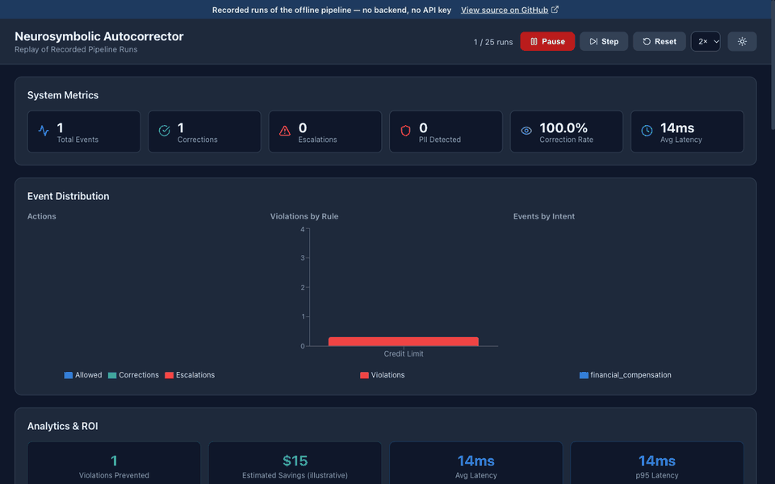
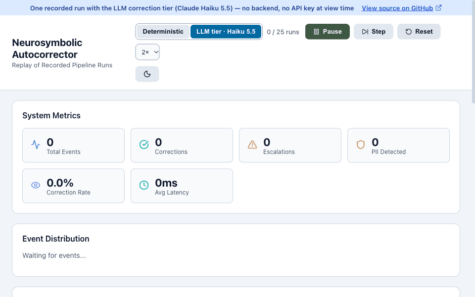
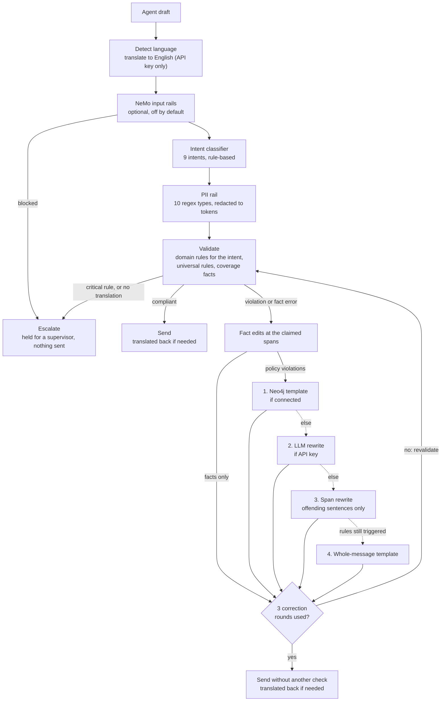

# Neurosymbolic Autocorrector

[](https://github.com/jasonmoorthy11-hub/neurosymbolic-autocorrector/actions/workflows/ci.yml)
[](LICENSE)

Policy-grounded, auditable correction of AI agent replies: each reply is routed to
allow, correct or escalate, and on the default offline path policy and fact fixes
are recorded as edits that cite their rule and source. The whole path runs
deterministically without an LLM (a small language-identification model sends
non-English replies to escalation); an LLM correction tier is optional.

**Live demo:** [jasonmoorthy11-hub.github.io/neurosymbolic-autocorrector](https://jasonmoorthy11-hub.github.io/neurosymbolic-autocorrector/) — a replay of recorded offline runs, no backend. The "LLM tier" switch ([`?lane=llm`](https://jasonmoorthy11-hub.github.io/neurosymbolic-autocorrector/?lane=llm)) plays one recorded run with Claude Haiku 5.5 as the correction tier.

**Results at a glance** (commands and full output in [docs/evaluation.md](docs/evaluation.md)):

- **What it does:** checks each reply against 8 policy rules, plan coverage facts and a 10-type PII rail, then allows, corrects or escalates it. No LLM on the default path; about 12 ms per reply.
- **Regression suite:** 517/517 actions correct on the golden set. Those cases were written alongside the code, so this shows nothing broke, not how accurate it is. A [mutation run](docs/evaluation.md#mutation-score-how-much-of-the-rule-set-the-golden-suite-pins-down) found the suite noticed only 43 of 104 single changes to the rules; with 56 rows written against the survivors it notices 98.
- **Blind test:** 53/60 actions correct (88.3%, 95% CI 77.8–94.2) on a held-out set written from the policy text and committed before its only run.
- **External PII benchmark:** precision 63.6%, recall 46.5% on the English rows of a public synthetic finance set. The regex rail misses about half of the spans.
- **Real agent turns:** on 19,144 human-written agent turns from a public role-play dataset, the pipeline flagged about 0.3% where the refund rule cannot fire, and about 3 in 10 of those flags were right (16 of 57 and 15 of 50). Most flags on other people's wording were wrong. The [audit](docs/evaluation.md#real-agent-turns-results-one-run-2026-11-09) lists every class; two were fixed afterwards; the other two, among them the largest (the refund rule firing on the word), were not; the data was not re-scored.





> Personal project, sole author; demoed to a prospect in Feb 2026, never in production there; later reused as a review gate in separate client work.

**What this is not**

- **Not a trained model.** Rules, regular expressions and templates make the policy, fact and PII decisions. The one trained component on the default path is an off-the-shelf language identifier (non-English replies escalate); an LLM is used only by the optional correction tier and translation.
- **Not a general PII detector.** The rail is US-format regex (numbers above; per-type results in [docs/evaluation.md](docs/evaluation.md#external-pii-benchmark)).
- **Not a real policy domain.** The rules and plans belong to one fictional company and were written by the author, as were both test sets.
- **Not a production deployment.** The demo, the tests and every number here run on synthetic text, not on real customer traffic.

The full list of known gaps is under [Limitations](#limitations).

**Five minutes, by what you care about**

| If you work on | Read |
|---|---|
| Applied AI, agents | The [live demo](https://jasonmoorthy11-hub.github.io/neurosymbolic-autocorrector/), then [Architecture](#architecture) and the correction tiers in [docs/architecture.md](docs/architecture.md#correction-tiers) |
| Safety, evals | [docs/evaluation.md](docs/evaluation.md): the held-out protocol, [every miss classified](docs/evaluation.md#every-miss-classified), and [Limitations](#limitations) |
| Product | The demo's [LLM tier lane](https://jasonmoorthy11-hub.github.io/neurosymbolic-autocorrector/?lane=llm), then [docs/case-study.md](docs/case-study.md): 13 things that were wrong and how each was found |
| Platform, infrastructure | [Quick start](#quick-start-offline-no-api-key), the [MCP server](#mcp-server), [docs/deployment.md](docs/deployment.md) and the [CI workflow](.github/workflows/ci.yml) |

## What it does

A customer-service agent drafts a reply. Before it reaches the customer, the
pipeline checks it against a small policy knowledge graph (8 rules, plan coverage
facts) and a PII rail (10 types), then does one of three things:

- **Allow**: the reply passes unchanged.
- **Correct**: policy and fact problems are fixed by rewriting only the offending
  sentence where possible (otherwise a whole-message template). On the offline path
  each edit records the rule and the policy section or page it came from (LLM-tier
  edits list rule ids only). PII is replaced with
  type tokens such as `[SSN REDACTED]`; the types found are listed with the result,
  not as edits.
- **Escalate**: the reply is held for a supervisor, with no rewritten text.

Two recorded runs from [`dashboard/public/replay/replay.json`](dashboard/public/replay/replay.json):

**Correct** (S01, account tenure 45 days):

| | |
|---|---|
| Agent draft | I can offer you a $200 credit for the inconvenience. |
| Rule | CREDIT-001 Credit Authorization Threshold: "Credits over $50 require 90+ days account tenure" (Credit_Policy_2024_v3.2, Section 4.1) |
| Delivered | I can offer you a $50 credit for the inconvenience. If you need more than that, I can ask a supervisor to review it. |

**Escalate** (S04, account tenure 30 days):

| | |
|---|---|
| Agent draft | I'll apply a $1,000 credit to your account immediately. |
| Rules | CREDIT-001 (high) and CREDIT-002 Maximum Credit Amount: "Single credit cannot exceed $500 without supervisor approval" (critical, Section 4.3) |
| Delivered | nothing: action `escalate`, no edits, held for a supervisor |

## Architecture



The first correction tier that applies wins; with no API key and no Neo4j, which is
the default, corrections come from tiers 3 and 4. A span edit counts as resolving a
rule only if the rewritten text no longer triggers it. The corrected text is
validated again, so it can still escalate; after three rounds it is sent without
another check.

`run_autocorrection` runs this graph. The dashboard API calls it and writes each
result to the SQLite audit store (append-only events, supervisor decisions kept
separately); the replay recorder calls it directly. The MCP tools run a lighter
path: the PII rail, policy and fact checks and the correction tiers, without
translation or revalidation. More detail in [docs/architecture.md](docs/architecture.md).

## Quick start (offline, no API key)

Python 3.12 to 3.14 (CI runs 3.12 and 3.14). Python 3.15 is refused at install:
one dependency of `guardrails-ai` does not build there yet. If `python3` is newer,
create the environment with `python3.14 -m venv .venv`.

```bash
git clone https://github.com/jasonmoorthy11-hub/neurosymbolic-autocorrector.git
cd neurosymbolic-autocorrector
python3 -m venv .venv && source .venv/bin/activate
pip install -e ".[dev,langgraph,guardrails]"   # or: uv venv && uv pip install -e ".[dev,langgraph,guardrails]"

python3 scripts/demo.py       # 15 scenarios, step by step and through the full pipeline
python3 scripts/evaluate.py   # golden set
```

`".[all,dev]"` adds the Neo4j driver. An Anthropic key in `AUTOCORRECTOR_ANTHROPIC_API_KEY`
enables the LLM correction tier and translation; nothing below needs one.

## Evaluation

Four numbers, kept separate because they mean different things. All are from
[docs/evaluation.md](docs/evaluation.md), which has the verbatim command output.

| Set | What it is | Result (95% Wilson CI) |
|---|---|---|
| Golden, 517 cases | Self-authored, **in-sample**: written alongside the code and used during development; 107 rows added after the held-out run | 517/517 actions correct (99.3–100.0) |
| Held-out, 60 cases | Self-authored, **held-out**: written blind from the policy text, committed before its first run | 53/60 actions correct, 88.3% (77.8–94.2) |
| External PII spans | gretelai/synthetic_pii_finance_multilingual, test split, our 10 PII types | English: precision 63.6% (62.0–65.3), recall 46.5% (45.1–48.0); all 7 languages: 55.4% / 34.2% |
| Real agent turns | ABCD v1.1, 19,144 human-written agent turns, three assumed customer contexts, one run before the fixes it led to | Flagged 0.30%, 0.26% and 3.03% of turns; flags that were right: 28.1% (18.1–40.8), 30.0% (19.1–43.8), 41.8% (37.9–45.9) |

The in-sample score is a regression suite, not evidence of accuracy. The held-out
set was run once; those numbers stay as first reported, and every one of its 7
misses is classified in [docs/evaluation.md](docs/evaluation.md#every-miss-classified)
(5 bugs, 1 ambiguous case, 1 deliberate fail-closed limitation). Held-out precision
was 30/32 = 93.8% (79.9–98.3) and recall 30/35 = 85.7% (70.6–93.7), with "flagged"
meaning any non-allow action.

```bash
python3 scripts/evaluate.py --dataset heldout   # already run once (results above); re-running it does not make it blind again
python3 scripts/bench_pii.py                    # downloads the benchmark once into .cache/
python3 scripts/bench_real_turns.py --input turns.jsonl   # what the pipeline flags in your own JSONL of agent turns
python3 scripts/mutate_policy.py                # mutation score of the golden set (about 70 s)
python3 scripts/evaluate.py --invariants        # structural checks on the corrected text
```

The corrected text itself gets four structural checks, on the 230 cases of the
golden set that the pipeline corrects. All 230 are idempotent: checked again, the
corrected text is allowed unchanged. Of the 183 with recorded edits (the other 47
are PII redaction only), every one cites a section or page that exists for the rule
or limit it names; the edit log reproduces the delivered text byte for byte in 180
(the other three differ by a trailing space); and in the 13 that leave a sentence
untouched, that sentence is delivered unchanged. They do not judge whether a
correction is the right answer
([details](docs/evaluation.md#corrected-text-structural-checks)).

**Latency:** p50 12.0 ms, p95 14.2 ms per reply over the golden set as it stood on
2026-11-06 (Apple M5, macOS 26.6.2, Python 3.14.7, in-memory store, offline; second
of two consecutive runs). The first case includes loading the language-detection model and
falls above p95.

## How this compares

Rewriting instead of blocking is not new. What this project adds is the bookkeeping
around the rewrite: on the default path each policy or fact edit is tied to a rule
and its source, routing between allow, correct and escalate is explicit, and the
same input always gives the same audited output.

| | On a violation | Edits cite a source | Needs a model |
|---|---|---|---|
| This project (default path) | Rewrites the offending sentences, or escalates | Yes: rule id, document, section or page | No LLM: rules, regexes and a small language-identification model |
| [Presidio](https://github.com/data-privacy-stack/presidio/tree/main/docs) | Replaces, redacts, masks, hashes or encrypts PII | For PII: each result can report the recognizer, pattern and context words behind it | A spaCy NLP model plus patterns |
| [Guardrails AI](https://github.com/guardrails-ai/guardrails/blob/main/docs/how_to_guides/use_on_fail_actions.ipynb) | Per validator: raise, log and continue, fix (where the validator supplies a fix), re-ask the LLM, or a custom handler, among others | Not described in the linked guide | Depends on the validator; re-ask needs an LLM |
| [NeMo Guardrails](https://docs.nvidia.com/nemo/guardrails/latest/about-nemo-guardrails-library/overview) | Output rails filter, edit or block | Not described in the linked page | Rails can use an LLM, a safety model, a third-party API, custom Python actions or Colang flows |
| [Llama Guard 3](https://huggingface.co/meta-llama/Llama-Guard-3-8B) | Labels a prompt or response safe or unsafe, with the categories violated | n/a | It is an LLM |

Each cell for another tool restates the documentation linked in its row (for
Presidio, the anonymizer and analyzer pages), read on 2026-11-09; these projects
change quickly. One thing was measured: Presidio with its default recognizers on
the English rows of the external PII benchmark, over the 7 PII types both cover.
The answer depends on where Presidio's score is cut. At ≥ 0.5 it is far more
precise than this project's regex rail (90.7% against 58.7%) with lower recall
(66.5% against 72.9%); at ≥ 0.4 it has higher recall (80.1%) and lower precision
(48.8%). It has no recognizer for street addresses or dates of birth
([details](docs/evaluation.md#compared-with-presidio-english-2026-11-09)).
Presidio is not a dependency.

## Replay demo (no backend)

The dashboard can run as a static site that replays recorded pipeline runs instead
of calling the API. Each scenario shows a trace: intent, PII found, rules violated,
and every edit with its before/after text and policy citation.

```bash
python3 scripts/record_replay.py           # writes dashboard/public/replay/replay.json
python3 scripts/record_replay.py --check   # exit 1 if the file is stale (CI runs this)
python3 scripts/record_replay.py --llm     # one paid run with the LLM tier -> replay_llm.json (key inline; never in CI)
cd dashboard && npm ci && VITE_REPLAY=1 npm run dev
```

The recording covers 25 scenarios (the 15 demo scenarios and the 10 dashboard demo
scenarios), run through the offline pipeline. The recorder refuses to run while an
API key is set or NeMo rails are on, so every recorded correction comes from the
deterministic path. Latencies are wall time on the recording machine after one
untimed warm-up run. The live dashboard (FastAPI on :8000, React on :3000) starts
with `./scripts/start_dashboard.sh`, or with Neo4j behind it via
`docker compose up --build` ([docs/deployment.md](docs/deployment.md)).

## MCP server

The package installs an `autocorrector` command that serves three tools
(`validate_action`, `get_correction`, `log_correction_event`), three resources
(`rules://compliance/{domain}`, `policies://active`, `metrics://corrections/summary`)
and one prompt (`review_correction`) over the Model Context Protocol.

```bash
autocorrector --stdio                                    # stdio transport
autocorrector                                            # streamable HTTP on 127.0.0.1:AUTOCORRECTOR_PORT (default 8000, which the dashboard API also uses: change one to run both; AUTOCORRECTOR_HOST=0.0.0.0 to listen on every interface); AUTOCORRECTOR_MCP_API_KEY enables auth
claude mcp add autocorrector -- autocorrector --stdio    # add to Claude Code
npx @modelcontextprotocol/inspector autocorrector --stdio
python3 scripts/test_mcp_client.py                       # client check over stdio: calls each tool, reads each resource
```

The MCP tools redact PII, check policy and facts and apply corrections, but they do
not translate: non-English text always escalates there.

To register the server in a project, put this in a `.mcp.json` file at the project
root (the repo does not ship one):

```json
{"mcpServers": {"autocorrector": {"command": "autocorrector", "args": ["--stdio"]}}}
```

## Limitations

Known, measured, or found by the held-out run:

- Fixed after the held-out run, with new golden rows (GAP-001 to GAP-011) rather
  than by re-scoring the held-out set: rules were checked only under the classified
  intent (one refund keyword fell under the classifier's floor, the intent became
  `general`, and the refund rules never ran), so every rule now runs on its own
  triggers and keywords match at word starts; ESC-001 knows "regulator"; the
  date-of-birth pattern tolerates a few words after its cue; a limit quoted for
  another plan is checked against that plan instead of the customer's. The
  held-out numbers above are from the first run and stay as reported; a new
  accuracy claim needs a new blind set.
- Fixed after v1.5, with golden rows GAP-012 to GAP-024: a keyword matched any word
  that started with it, so "Thanks, Sue." and "suede boots" were escalated as legal
  threats. Keywords now match the whole word or phrase and its regular inflections.
  What remains: a derived form that is not listed as a keyword does not match
  ("creditworthy"), and "Sue" counts as a name only in a greeting ("Thanks, Sue."),
  so "Sue will call you back" still escalates. That is deliberate: wider name
  rules missed real threats in review.
- Language detection is an off-the-shelf model plus guards added after the real-turn
  audit (RT-001 to RT-008), and both directions still fail. Escalated though
  English: typo-ridden lines with fewer than two common English words ("ok im
  looking now") and lines of several codes ("order C3EDQM ref EVXRVC"). Checked as
  English though foreign, so the English-only rules pass them: a line of under
  four unaccented words with no amount ("Gracias por esperar.", and since v1.6
  also "J’ai rembourse" with a curly apostrophe and "Rabatt 20" with one word
  beside the number), and a line that carries two or more English marker words
  and fewer than two function words of Spanish, French, Portuguese, German,
  Italian or Dutch ("Garantiert: your new Erstattung today"). Function words of
  other languages are not known at all, so an unaccented Indonesian or Tagalog
  line with two English words in it passes as English.
- The credit rules need a credit word ("credit", "compensation", "discount", ...).
  A payment that is not called one ("As an apology I'm sending $600 to your
  credit card") is not seen; before v1.6 it was caught by accident, because
  "credit card" read as a credit. Since v1.6 "credit card" is skipped only after
  a word that marks a noun ("your", "the", "a", "by", "which" ...). Without one
  it still reads as a credit, because it may be the verb ("I'll credit card
  ending 4417 with $90"), so "We accept cash and credit card for orders over
  $600" is still escalated as an over-limit credit. The other way round, a
  credit that runs into "card" with no punctuation after such a word is read
  as the card ("I've added the credit card ending 4417 will show $80"), and so
  is a credit offered as "a credit or debit card refund".
- The refund-window rule (REFUND-001) fires on the word, not on granting a
  refund. Outside the 30-day window "So you'd like a refund for the
  headphones?", "That refund is still pending" and "I'm sorry, I can't refund
  this order" are all rewritten. On real agent turns this was the largest class
  of wrong flags (238 of 531 in the [audit](docs/evaluation.md#real-agent-turns-results-one-run-2026-11-09)).
  A carve-out for questions, refusals, status reports and statements of policy
  was written for v1.6 in five forms and removed: reviewers kept finding late
  refunds worded as exactly those things ("You'd like a refund? Sure thing.",
  "I can't refund you until tomorrow morning."), and a missed late refund costs
  more than a held refusal. Telling the two apart needs more than keywords.
- PROMISE-001 and SLA-001 fire on their keywords inside idioms too: "Promo codes
  don't last forever", "you'll never miss a clearance event" and "I will
  definitely be able to look into that" are rewritten as commitments. Blanking
  those idioms was tried for v1.6 and removed, because a commitment could ride
  on each ("Most promos don't last forever, but yours will.").
- The address pattern takes a number, some words and a street type. It skips a
  number followed, in lower case, by function words and then "way", "road",
  "place", "court", "drive" or "circle" ("72 is on its way"), or by a unit of
  time or count on the way to one ("5 years down the road"), so an address
  typed that way in lower case ("12 the drive", "4 days road") is not redacted
  unless a city, state and ZIP follow. A phrase like "72 is on its way back to
  Main Street" is still redacted as an address.
- Not fixable by a rule and left as they are: a store's street address or a
  company mailbox in a reply is redacted as PII like a customer's would be, and a
  refund that depends on a condition the reply states ("once we receive the item")
  is treated as granted.
- The intent classifier is keyword and regex matching. Since v1.2 one keyword hit
  scores at the pattern's base confidence (the score was divided by the keyword
  list's length before, so most replies read `general`), which means a noun used in
  another sense is enough to mislabel a reply: "credit card" reads as
  `financial_compensation`, "return your call" as `refund_processing`, "your
  package was delivered" as `product_inquiry`. The rules do not depend on the
  intent; the trace label and the ACE strategy lookup do, so strategies learned
  under `general` are no longer found for replies that now get a specific label.
- A coverage figure in the same sentence as a credit counts as an offer amount and
  escalates. This is deliberate (fail-closed), but it escalates some correct replies.
- A credit amount next to a coverage category ("a $600 emergency dental credit") is
  also read as a coverage claim and fact-checked; the action (escalate) is still
  right (held-out HO-ESC-02/03).
- When the whole-message template takes over (a rule the span tier cannot fix, such
  as an amount written in words), it replaces the entire reply; its one edit cites
  every rule that fired, but the wording comes from one rule's template.
- PII detection is US-format regex. On the external benchmark, IBAN/BBAN bank
  accounts have 0% recall and addresses 13.7% recall (all languages); phone and
  card precision are about 22%, so bare digit strings get redacted.
- The dashboard API key protects only approve/reject, export and demo endpoints;
  `/api/events`, `/api/queue` and the WebSocket are open. They serve the audit rows,
  which hold the text as the regex PII rail above redacts it (rows written before
  v1.1 are unchanged, the table is append-only). The replay demo uses fake PII only.
- The bundled React dashboard never sends that key, so with
  `AUTOCORRECTOR_DASHBOARD_API_KEY` set its approve/reject, export and demo buttons
  get a 401; the key is for API clients (`X-API-Key` or `Authorization: Bearer`).
  A key compiled into a browser bundle would be public, so the UI does not take one.
- The fact-claim heuristic misses some phrasings, for example a follow-up sentence
  such as "It covers $5,000." or "Coverage is capped at $5,000.", "I'll check if
  emergency dental covers $5,000.", "After your deductible dental coverage pays
  $5,000.", and an untyped unrelated amount in a single-mention clause.
- Span rewriter: the correction cache key omits the rule set and the supervisor
  strategies; with Neo4j connected, the span tier and the coverage exemption still
  use the in-memory rules and facts; REFUND-001 drops sentences that use "return" in
  other senses; fact-check edits put the page number in `source_section`; a credit
  named by category under the threshold goes to the whole-message template.
- Rules live in memory by default; Neo4j is optional and not part of the replay
  demo. The Docker stack (`docker compose up --build`, [docs/deployment.md](docs/deployment.md))
  seeds and uses it.
- Non-English replies escalate when no translation key is available (PII redaction
  still applies).
- The confidence shown is a fixed heuristic per outcome, not a calibrated
  probability. The dashboard's ROI figures rest on stated assumptions.
- The LLM tier appears in the replay only as one recorded run of the 25 scenarios
  (Claude Haiku 5.5, the `?lane=llm` switch; every rewrite is judged in
  [docs/evaluation.md](docs/evaluation.md#one-llm-tier-recording-claude-haiku-55-2026-11-05)).
  That is a demo lane, not a benchmark, and the replay latencies are from one machine.

## Supervisor feedback (ACE-style)

`ace/` holds an ACE-style supervisor-feedback loop (after Agentic Context
Engineering, Zhang et al., 2025, arXiv 2510.04618): a reflector turns rejected
corrections into lessons and a curator deduplicates and scores them; the top lessons
for an intent are passed to the LLM tier as strategies. Both the reflector and the
LLM tier call the Anthropic API, so the loop does nothing on the offline path.

## Configuration

Environment variables (prefix `AUTOCORRECTOR_`) or a `.env` file; see `.env.example`.

| Variable | Default | Description |
|----------|---------|-------------|
| `AUTOCORRECTOR_ANTHROPIC_API_KEY` | (empty) | Enables the LLM correction tier and translation |
| `AUTOCORRECTOR_CORRECTION_LLM` | `claude-opus-5-5` | Model for LLM corrections |
| `AUTOCORRECTOR_DEFAULT_LLM` | `claude-sonnet-5-5` | Model for translation |
| `AUTOCORRECTOR_NEO4J_URI` | (empty) | Neo4j connection URI (optional); when set, the dashboard API and MCP server connect at startup and fall back to memory if it is unreachable |
| `AUTOCORRECTOR_NEO4J_USER` / `_PASSWORD` | (empty) | Neo4j credentials |
| `AUTOCORRECTOR_NEO4J_DATABASE` | `neo4j` | Database the store and the seed script use |
| `AUTOCORRECTOR_NEMO_RAILS_ENABLED` | `false` | NeMo input rails. Needs the `[nemo]` extra (`nemoguardrails` and `langchain-openai`) and an OpenAI key in `OPENAI_API_KEY`: `configs/nemo/config.yml` runs the rails on OpenAI `gpt-3.5-turbo`. The tests cover it with mocks only, and the evaluation and the replay recordings run with it off, so this path is not verified end to end here |
| `AUTOCORRECTOR_GUARDRAILS_TELEMETRY` | `false` | Guardrails AI telemetry, off unless opted in |
| `AUTOCORRECTOR_MAX_CORRECTION_ATTEMPTS` | `3` | Correct-then-revalidate rounds |
| `AUTOCORRECTOR_MCP_API_KEY` | (empty) | Auth for the MCP HTTP transport |
| `AUTOCORRECTOR_DASHBOARD_API_KEY` | (empty) | Auth for dashboard approve/reject, export and demo endpoints |
| `AUTOCORRECTOR_AUDIT_DB_PATH` | `autocorrector_audit.db` | SQLite audit store |
| `AUTOCORRECTOR_CORS_ORIGINS` | `["http://localhost:3000"]` | Allowed CORS origins |
| `AUTOCORRECTOR_TRUSTED_PROXIES` | `[]` | Reverse proxies (addresses or CIDRs) whose `X-Forwarded-For` names the client for dashboard rate limiting; empty means the header is never read |
| `AUTOCORRECTOR_HOST` | `127.0.0.1` | Address the MCP HTTP server binds; `0.0.0.0` to listen on every interface |
| `AUTOCORRECTOR_PORT` | `8000` | Port of the MCP HTTP server (the `autocorrector` command). The dashboard API's port is uvicorn's `--port` (8000 in `scripts/start_dashboard.sh` and the Docker image) |

## Development

```bash
python3 -m pytest --ignore=tests/test_neo4j_integration.py   # the 16 Neo4j tests wipe their database and need an opt-in (docs/deployment.md)
ruff check src tests scripts && ruff format --check src tests scripts
cd dashboard && npm test                                      # vitest
```

CI ([`.github/workflows/ci.yml`](.github/workflows/ci.yml)) runs the tests, lint and
the replay drift check offline on Python 3.12 and 3.14, and lints, tests and builds
the dashboard (the build in both live and replay modes). It also runs the 16 Neo4j
integration tests against a disposable Neo4j service and builds both Docker images.
No secrets are used.

## Project structure

```
src/autocorrector/
├── intent_classifier/   rule-based intent detection (9 types)
├── guardrails/          PII rail (10 types), Guardrails AI wrappers, NeMo input rails
├── knowledge_graph/     policy rules + coverage facts (in-memory, optional Neo4j), correction tiers, span rewriter;
│                        ingestion.py and retriever.py are experimental and not on the correction path
├── orchestrator/        LangGraph pipeline
├── multilingual/        language detection + LLM translation
├── ace/                 supervisor-feedback reflector and curator
├── audit/               SQLite audit store (append-only events, separate decisions)
├── dashboard/           FastAPI REST + WebSocket
├── mcp_server/          MCP tools and resources
├── evaluation/          golden and held-out sets, Wilson scoring, runner, LLM judge
└── explainability/      human-readable correction reasoning
dashboard/               React 19 + TypeScript dashboard (live or replay)
scripts/                 demo, evaluate, bench_pii, record_replay, MCP client check
docs/                    evaluation, architecture, case study, deployment
```

## License

MIT, see [LICENSE](LICENSE).
